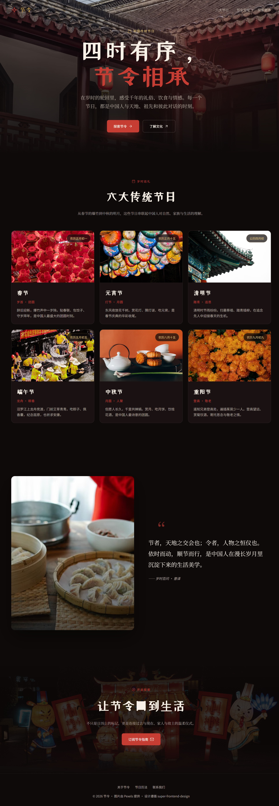
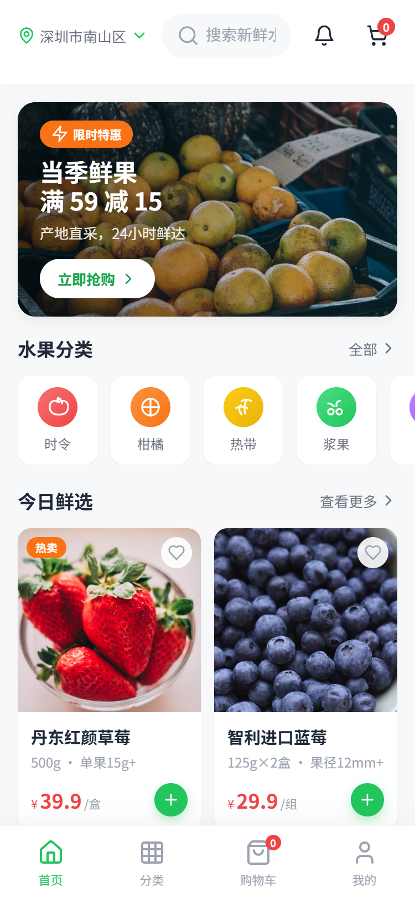
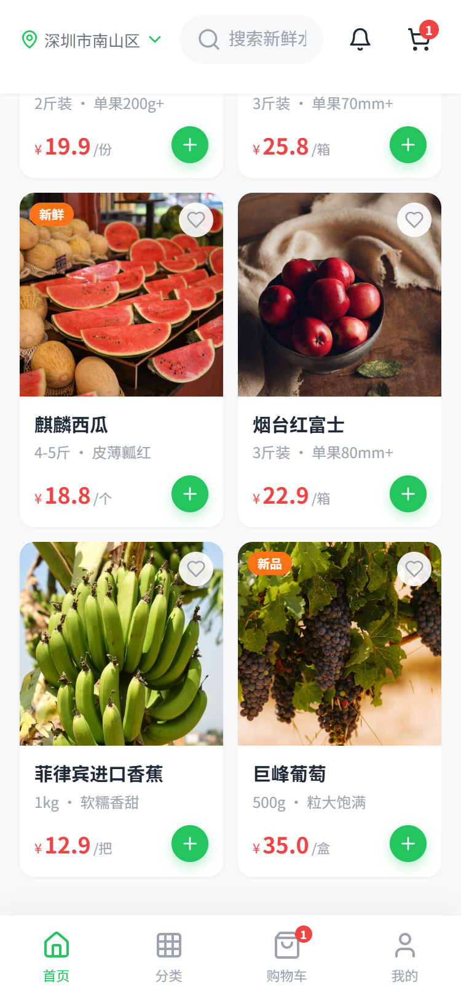

# super-frontend-design

一个 Claude skill，用于创建具有专业图标和真实摄影图的生产级前端界面。

与普通的前端生成不同，`super-frontend-design` 强制了两条硬约束，把业余设计提升到专业水准：

1. **禁用 Emoji，强制使用 Lucide / Tabler 内联 SVG 图标**
2. **禁用裸渐变背景，强制使用 Pexels 真实摄影/插画**

它适用于落地页、海报、营销站点、H5、管理后台、移动端界面等任何需要"像设计师出品"的前端场景。

---

## 目录

- [为什么需要这个 skill](#为什么需要这个-skill)
- [升级点](#升级点)
- [快速开始](#快速开始)
- [目录结构](#目录结构)
- [核心设计规范](#核心设计规范)
- [示例展示](#示例展示)
  - [节令 · 中国传统节日](#节令--中国传统节日)
  - [鲜果集 · 手机生鲜商城](#鲜果集--手机生鲜商城)
- [获取 Pexels API Key](#获取-pexels-api-key)
- [图标规范](#图标规范)
- [图片规范](#图片规范)
- [注意事项](#注意事项)

---

## 为什么需要这个 skill

大多数 AI 生成的前端界面看起来"还不错"，但细看总有以下通病：

- 用 Emoji 充当按钮、状态、导航图标，显得粗糙
- 用纯色或渐变背景填充整个页面，缺乏真实视觉层次
- 字体、配色、布局趋同，缺乏品牌记忆点
- 图片缺失或盗用低质量素材

`super-frontend-design` 通过**素材规范 + 设计约束**解决这些问题，让生成的代码：

- 视觉专业：真实摄影 + 矢量图标
- 风格鲜明：明确的美学方向（极简、极繁、复古未来、编辑风等）
- 可直接运行：生产级 HTML/CSS/JS，带响应式和基础交互

---

## 升级点

| 维度 | frontend-design | super-frontend-design |
|------|----------------|----------------------|
| 图标 | 可能使用 Emoji | **强制使用 Lucide / Tabler 内联 SVG** |
| 配图 | 依赖渐变背景 | **强制使用 Pexels 真实摄影作品** |
| 专业度 | 创意优先 | 创意 + 专业素材规范 |
| 集成 | 无外部服务 | Pexels API 集成与环境变量配置 |
| 美学方向 | 较通用 | 明确、鲜明、可记忆 |

---

## 快速开始

1. 克隆或复制本 skill 到 Claude skills 目录。
2. 配置 Pexels API Key：

```bash
cp .env.example .env
# 编辑 .env，填入你的 Pexels API Key
```

3. 在 Claude 中使用 `/super-frontend-design` 或在提示中引用本 skill。
4. 开始描述你想要的页面，例如：
   - "帮我做一个中国传统节日的文化展示页"
   - "做一个手机生鲜电商首页"

---

## 目录结构

```
super-frontend-design/
├── SKILL.md              # Claude skill 主文档（完整提示词与约束）
├── README.md             # 本说明
├── LICENSE.txt           # Apache 2.0
├── .env.example          # 环境变量示例
├── templates/
│   ├── pexels-service.js # Pexels API 封装示例
│   ├── icon-system.md    # 图标使用速查表
│   └── example-hero.html # Hero 区域参考模板
└── examples/
    ├── chinese-festivals/    # 示例：中国传统节日文化页
    └── mobile-fruit-shop/    # 示例：手机生鲜商城首页
```

---

## 核心设计规范

本 skill 的完整规范见 `SKILL.md`，核心约束如下：

### 图标约束

- **永远不要使用 Emoji** 作为 UI 图标、装饰符号或状态标识
- 仅使用 **Lucide Icons** 或 **Tabler Icons** 的内联 SVG
- 统一 `stroke-width`、尺寸和颜色
- 装饰性图标加 `aria-hidden="true"`，图标按钮加 `aria-label`

### 图片约束

- **永远不要只用渐变背景** 作为视觉主体；渐变仅可作为叠加层或点缀
- 每个主要区块（hero、features、testimonials、CTA、about）都应配相关图片
- 使用 Pexels 真实摄影或插画
- 图片必须提供 `alt` 文本
- 使用响应式属性：`srcset`、`loading="lazy"`、`decoding="async"`
- 叠加半透明遮罩保证文字可读性

### 美学约束

- 字体：避免 Arial / Inter / Roboto，选择有特点的字体组合
- 配色：主色 + 强调色，形成强烈视觉记忆
- 动效：CSS 优先，关键节点使用入场动画和悬停反馈
- 布局：敢于使用非对称、重叠、破格网格、大量留白或高密度

---

## 示例展示

### 节令 · 中国传统节日

一个深色国风文化展示页，使用传统建筑摄影、朱砂红与金色强调，搭配 `ZCOOL XiaoWei`、`Noto Serif SC` 等中式字体。整页无 Emoji，全部使用 Lucide 内联 SVG 图标；每个节日卡片均配有 Pexels 真实摄影。




**文件位置**：`examples/chinese-festivals/index.html`

**亮点**：
- Hero 使用传统建筑飞檐大图 + 渐变遮罩
- 六大节日卡片，每张配图真实摄影
- 引言区图文混排，营造文化氛围
- 滚动时导航栏自动添加毛玻璃背景
- 使用 `IntersectionObserver` 实现滚动入场动画

---

### 鲜果集 · 手机生鲜商城

一个移动端 H5 水果商城首页，采用清新绿色主题，针对 480px 以内屏幕优化。包含搜索栏、Banner、分类入口、商品双列瀑布流、底部导航和可交互的购物车数量控制。






**文件位置**：`examples/mobile-fruit-shop/index.html`

**亮点**：
- 全部图标使用 Lucide SVG（定位、搜索、通知、购物车、分类、收藏、加减等）
- Banner 和商品图均来自 Pexels
- 商品卡片支持收藏切换
- 购物车按钮支持加购、增减数量、角标联动
- 底部固定导航，适配安全区

---

## 获取 Pexels API Key

1. 访问 https://www.pexels.com/api/
2. 注册/登录后申请 API Key
3. 将 Key 填入 `.env` 或系统环境变量 `PEXELS_API_KEY`

```bash
PEXELS_API_KEY=your_key_here
```

---

## 图标规范

- Lucide: https://lucide.dev
- Tabler: https://tabler-icons.io
- 使用内联 SVG，不要作为 `` 加载简单 UI 图标
- 统一 stroke-width、尺寸和颜色

常用图标映射可参见 `templates/icon-system.md`。

---

## 图片规范

- 每个主要区块（hero、features、testimonials、CTA、about）都应有一张相关图片
- 使用响应式属性：`srcset`、`loading="lazy"`、`decoding="async"`
- 为图片提供合适的 `alt` 文本
- 使用半透明覆盖层保证文字可读性

---

## 注意事项
- 若未配置 `PEXELS_API_KEY`，生成代码时会嵌入稳定的 `images.pexels.com` URL，并附带 `// TODO: configure PEXELS_API_KEY` 注释。
- 本 skill 强调"视觉差异化"，请明确告诉 Claude 你想要的美学方向（如极简、极繁、复古、工业、杂志风等），以获得更贴合预期的结果。
